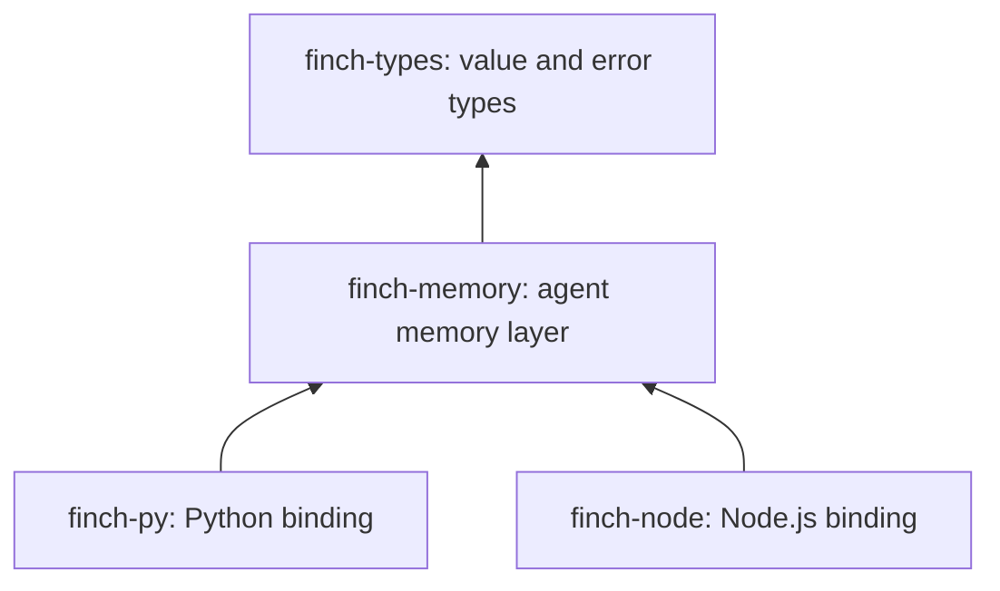
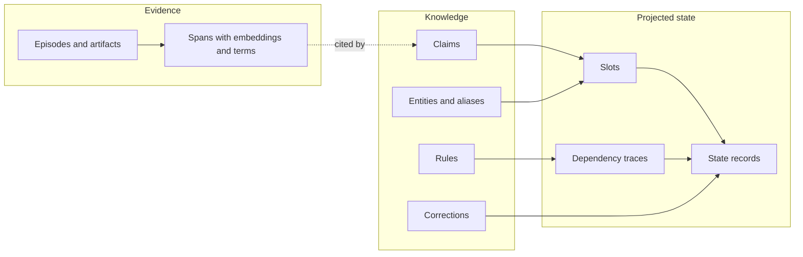
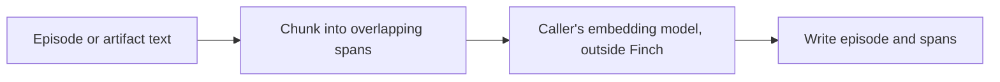
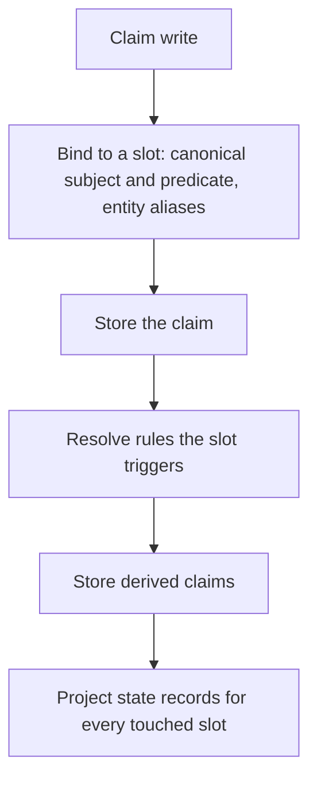
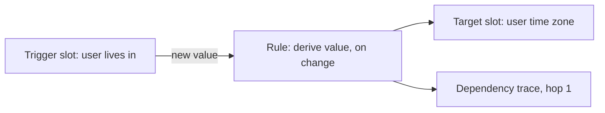
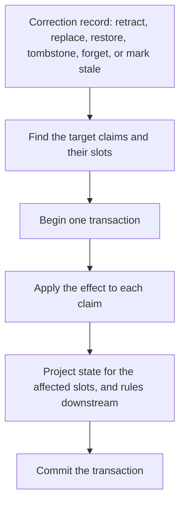
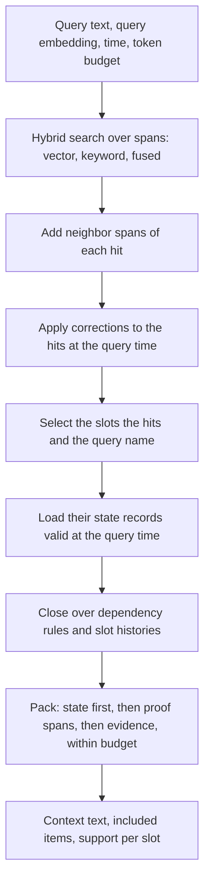

# Finch Architecture

## 1. What Finch is

Finch is a memory layer for language-model agents. It stores conversation episodes, the claims
extracted from them, and the corrections and rules that change those claims. It keeps its
records in Postgres with the pgvector extension, and it packs current state with its source
text into a context for a model to answer from.

An arrow points from a crate to a crate it depends on.

## 2. What the memory layer stores

A memory store is one Postgres schema, and each record kind has its own table. Section 14 tells
how the store uses Postgres.

Evidence is what happened. An episode is one event, such as a user message or a tool result. An
artifact is a file, a page, or a document. Finch splits their text into overlapping spans. Each
span holds its text, a caller-supplied embedding under an HNSW index, and a row of term counts
for keyword search.

Knowledge is what the caller says the evidence means. A claim names a subject, a predicate, and a
value, and cites the spans it came from. "The user lives in Denver" has subject "user", predicate
"lives in", and value "Denver". A correction changes the standing of a claim. A rule links two
slots, so a change in one can change the other. An entity is a person, place, or thing with a
canonical name and aliases.

Projected state is what Finch computes from knowledge. A slot is one subject and predicate pair.
A state record is one version of what a slot held, with the claims, corrections, and rules that
produced it. A dependency trace records which rule derived a state record from which claim.

Every record carries a scope: a space, and optional tenant, user, agent, project, and thread ids.
Every read and write filters on the scope, so one store can hold many users. A read at a scope
also returns the records of narrower scopes. A write changes records of its own scope only.

## 3. Ingest

Finch cuts the text into spans of a fixed number of characters with an overlap. A sentence
that straddles a cut therefore appears whole in one of the two spans. The caller embeds each span. Finch
writes the episode and the spans. Each span row holds its vector and the list of distinct
words in it, with a GIN index on that list. Ingest writes no claims. The caller runs its own extractor over the spans and writes
the claims it finds.

### Extraction queue

Each episode write also adds one extraction job in the same transaction. Thus a message write
returns before the extractor runs, and no episode is lost from the queue. A background worker
calls `lease_extraction_jobs` with its worker id and a lease time. It gets up to a limit of jobs,
in sequence order. Then it runs the extractor and calls `complete_extraction_job`. This call
deletes the job, so the queue holds only the jobs that are not complete.

Each extraction reads the state that the earlier extractions of its scope wrote. Thus a job is
free only when no earlier job of the same exact scope is pending, leased, or failed. Jobs of
different scopes lease in parallel. Two workers never get the same job, because the lease locks
each row with `FOR UPDATE SKIP LOCKED`. A partial index on the scope, the sequence number, and
the id of open jobs keeps the check of earlier jobs fast on a long queue.

When a lease expires, another worker can lease the job. Each expired lease counts as one attempt,
because a worker that stops never calls fail. At the `max_attempts` of the lease request, the job
becomes failed with an error that says the lease expired.

A worker can also name its job in the state mutation batch that holds the extracted records.
The batch then completes the job in its own transaction. If the worker no longer holds the
lease, the batch writes nothing. Thus a worker that stops after its write never writes the
same extraction twice.

Only the worker that holds the lease can complete or fail the job. `fail_extraction_job` returns
the job to pending, or marks it failed at its maximum number of attempts. A failed job stops the
later jobs of its scope. The caller then calls `retry_extraction_job` or `skip_extraction_job`.

`extraction_backlog` gives the number of jobs that wait and the write time of the oldest. A
nonzero backlog tells a reader that the state is behind the conversation. Span search finds the
raw text before extraction.

## 4. Claims and state

A claim write binds the claim to a slot. Finch normalizes the subject and the predicate into
keys, and an alias table maps a subject such as "my brother" to the entity it names. When a
subject gets an entity later, Finch moves the claims of that name into the entity's slots and binds
the rules again, so the old and new claims stay in one slot. A name that two entities share stays
unlinked. Then Finch stores the claim and runs the rules that the slot triggers. It stores the
claims those rules derive and projects new state records for every slot the write touched. The
write returns after the projection, so the next read sees the new state.

A state record has two timelines. Valid time says when the fact held in the world. Transaction
time says when Finch recorded and superseded the record. Say the user moved to Denver in March and
said so in May. Then the valid time starts in March and the transaction time starts in May. A read
can ask for the current state, for the state at a valid time, or for what Finch knew at a
transaction time.

A newer claim on the same slot supersedes the older one. Both stay stored, and the older one
keeps its valid interval. State records have six kinds: current, set, tombstone, unsupported,
derived, and rule. A set record holds every member of a set-valued slot, such as the user's
allergies. A tombstone says the slot held nothing from a given time. An unsupported record says
the old value no longer has evidence behind it.

Version ids hash the batch that wrote them, not the clock. Replaying the same writes yields the
same ids and the same state.

## 5. Rules

A rule links a trigger slot to a target slot. When the trigger changes, the rule either derives a
new value for the target from a template, or marks the target unsupported. For example, a rule
can say that a change of the user's city makes the user's stored commute time unsupported. A rule
fires on change, or on every projection when the caller asks for that. Derived claims can
trigger further rules up to a fixed number of hops, and each hop writes a dependency trace. A
read follows the traces back to the claim that started the chain.

## 6. Corrections and forgetting

Finch never edits a stored claim in place. A correction is its own record. It names its target
by claim ids or by slot. It carries the time it takes effect and who asked for it. A retract
ends the claim's validity at that time. A replace also writes a new claim with the new value. A
restore brings a retracted claim back. Any rule that depends on the affected slot fires again,
so a derived value falls with its source.

A forget hides its target claims, as a tombstone does, so the slot shows that the value is gone.
Every search also replaces a forgotten value with `[forgotten]` in the span text that it returns,
so a reader does not see the value in the raw text that stated it. The data stays stored, so a
mistaken forget can be undone.

`MemoryStore::purge_forgotten(&scope, before_ms)` deletes what the forgets of the scope hide, for
each forget that took effect before `before_ms`. It deletes the forgotten claims and the records
that Finch derived from them: derived claims, state records, dependency traces, edges, and
profiles. Entities, aliases, and slots lose the ids of the deleted claims, and Finch deletes the
ones that have no evidence left. Purge also replaces the forgotten values in the text of the
cited episodes and spans, and clears the vectors of those spans. The report names these spans,
so the caller can embed them again. The correction record stays, but it holds no selector, new
value, reason, or metadata that names a forgotten value. In each single-valued slot, a marker
claim with no value keeps the tombstone, so an older value does not become current. A purge
that finds nothing left to delete changes nothing.

Two calls delete stored data. `MemoryStore::erase_scope(&scope)` deletes every row of the scope
and of each scope inside it, in every table. Rows of broader scopes and of other scopes stay.
`MemoryStore::erase_episodes(&scope, &ids)` deletes the episodes and their spans. It also deletes
each claim, rule, and correction that cites them, with the records derived from those, as a
purge does. Then Finch projects the state of each affected scope again. A claim that another
episode supports stays. Each call returns the number of deleted rows per table.

Every state write changes several tables: the batch write API, the single writes of a claim,
correction, rule, entity, or slot alias, the scope rebuild, and the two erase calls. Each one runs as one Postgres
transaction. When the write completes, the transaction commits. When it fails, or the process
dies first, Postgres discards every change of the write. A read runs in one read-only snapshot,
so it sees the whole write or none of it.

## 7. The memory read path

A read searches the spans two ways. The vector index finds spans near the query embedding, and
BM25 ranks the spans that hold the query words. Finch fuses the two rankings by reciprocal rank
and keeps hits from many sources rather than one. It adds the spans next to each hit, so a
cut sentence reads whole.

The hits and the query name a set of slots. Finch loads the state records of those slots that
were valid at the query time. It adds every slot a dependency rule links them to and loads
the history of each slot. The result is a projection: claims, set states, tombstones, rule outcomes,
corrections, and the spans that prove them.

The packer fills the token budget in a fixed order. State comes first: the slots the query asks
about, then entity cards, then other claims, sets, corrections, and rules. Then the spans that
prove that state, then the other evidence spans, then slot histories, then profiles and
artifacts. The output is the context text, the list of included items, and a support flag per
slot. The flag says whether the packed context has evidence for that slot, has none, or holds a
tombstone. With the same records and the same hits, the packer writes the same context.

## 8. Memory storage in Postgres

A memory store keeps its records in Postgres with the pgvector extension. A `PostgresStore`
gives the server URL, the schema name, and the maximum number of connections, which is 8 by default.
`MemoryStore::create(&store, dim, vector_index)` creates the store in a new schema, and fails if
that schema exists. `MemoryStore::open(&store)` opens it. `drop_store(&store)` deletes it with all
its rows.

The `sslmode` value in the URL sets TLS: `disable`, `prefer` (the default), or `require`. TLS always
verifies the server certificate against the public web roots. A server with its own certificate
authority, such as Amazon RDS, also needs its PEM bundle in `tls_root_certificates`.

A state mutation holds an exclusive state lock on its exact scope and shared state locks on every
broader scope. An erase also holds an exclusive erase lock on its exact scope and shared erase locks
on every broader scope. Erase keys and state keys use separate advisory lock namespaces. Each key
also includes the store name, so stores in one database do not wait for each other. Other
writes hold shared erase locks on every record scope and every broader scope. Bulk writes sort these
keys and remove duplicates before they write rows. Shared erase locks let these writes run together
and with state mutations.

Each erase and each write in its scope run in sequence, in every process. A state mutation batch
checks evidence and provenance under its state locks, in the transaction that writes the batch. A
store opens connections as it needs them, up to its maximum. A connection that the server closes
opens again.

With `vector_index`, each embedding column gets an HNSW index on its halfvec form. That index
accepts up to 4,000 dimensions and is half the size of a full-precision index. When the index
returns fewer rows than the limit, the search runs again without it, so a narrow filter gets
every match. Without the index, vector searches are exact. Every table has an index on space,
tenant, and user, so one store can hold the memory of many users.

An HNSW index slows each span write. To load many spans, create the store without
`vector_index`, write the spans, and then call `ensure_span_hnsw_index`. At 100,000 spans, this
is about three times faster than a store that updates its index on each write.

The table `finch_meta` holds the schema version of the store. `create` writes the current
version. `open` reads it under an advisory lock on the store, so two processes cannot upgrade
one store at the same time. When the version is lower, `open` applies each migration in order in
one transaction. When the version is higher than the code knows, `open` fails and names the two
versions. A store without `finch_meta` has version 0.

Migration 1 creates each table, column, and index that the current schema has and the store does
not have. It fills `lexical_terms` of each span that has rows in the table `memory_terms`, and
then deletes that table. Other spans get no keyword terms. It also fills `evidence_ids` of each
claim and `lexical_terms` of each state record, with the values that a write gives them.

Tenant isolation is off by default. Set `tenant_isolation` in `PostgresStore` to turn it on.
Then each table gets Postgres row-level security with a policy that shows only the rows of one
tenant. Each transaction sets that tenant from the `tenant_id` of its scope. An operation without
a tenant fails, and a table read or write outside an operation fails. `open` adds the policies to
an existing store. Open such a store with tenant isolation each time, because a store without the
tenant setting shows no rows. The Postgres role must not be a superuser and must not have
`BYPASSRLS`, because such a role ignores the policies. `create` and `open` fail for such a role.

## 9. Guarantees

- With the same records and search hits, the memory layer packs the same context.
- Every read and write of the memory layer stays inside its scope.
- A memory-layer write is one Postgres transaction: it takes effect whole or not at all, and it
  is durable when the transaction commits.
- An erase waits for writes in its scope to commit, or those writes wait for the erase to commit.
- A state mutation batch checks its evidence and provenance after it takes state locks and before it
  writes rows.
- A claim, a correction, and a rule never change after Finch stores them. A new record
  supersedes an old one. Only a purge or an erase deletes one.
- A purge, `erase_scope`, and `erase_episodes` delete rows with SQL `DELETE`. After the
  transaction commits, no read returns the deleted records. Postgres keeps the old row data in
  its files until `VACUUM` reuses that space.
- A read at a past valid time or a past transaction time returns the versions that held then.
- The same writes in the same order produce the same version ids.

## Where to look

| Concept | Path |
|---|---|
| Workspace crates | `Cargo.toml` |
| Filter parsing | `crates/finch-memory/src/filter.rs` |
| Memory tables and their fields | `crates/finch-memory/src/schema.rs` |
| Chunking and ingest | `crates/finch-memory/src/ingest.rs` |
| Hybrid span search | `crates/finch-memory/src/store/search.rs` |
| Claim binding and state projection | `crates/finch-memory/src/store/state_records.rs` |
| Rules and dependency traces | `crates/finch-memory/src/store/rules.rs` |
| Corrections and claim lifecycle | `crates/finch-memory/src/store/lifecycle.rs` |
| Memory storage in Postgres | `crates/finch-memory/src/postgres.rs` |
| Answer-ready read | `crates/finch-memory/src/store/projection.rs` |
| Context packing | `crates/finch-memory/src/context.rs` |
